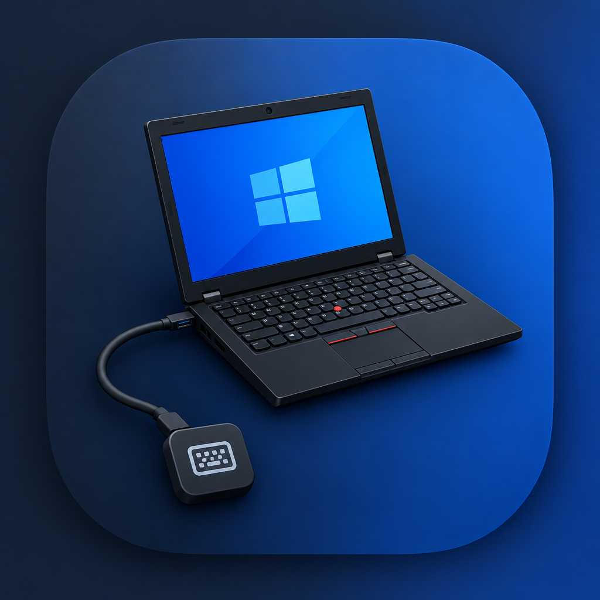
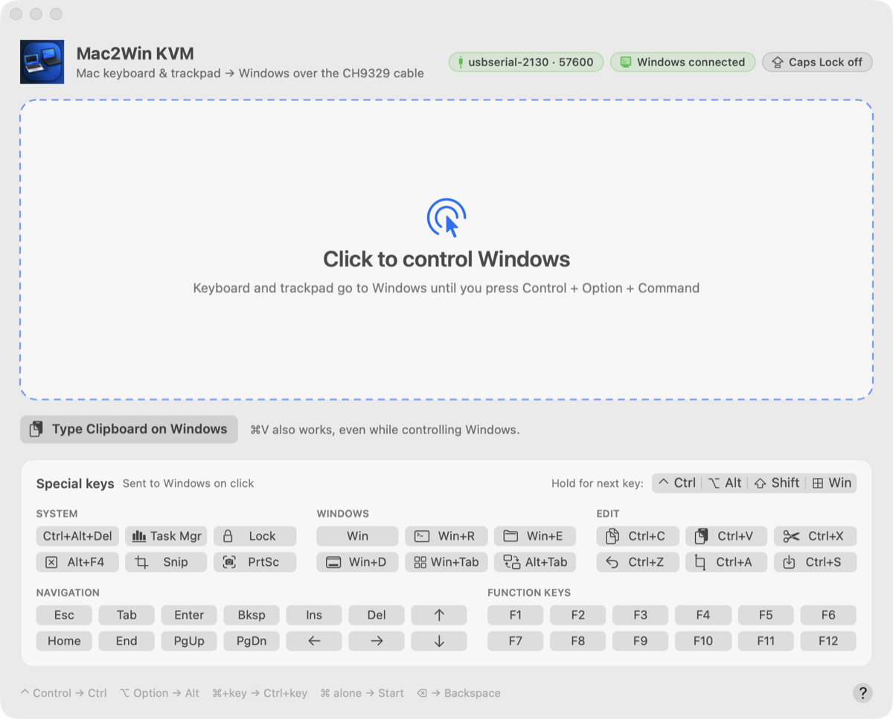

# mac-to-windows-keyboard



Type in a Mac terminal, or use the Mac keyboard and trackpad from a desktop window, and control a Windows computer through a CH340 + CH9329 USB keyboard/mouse-emulator cable. Windows sees a standard USB keyboard and mouse, so it needs no drivers or software.

```text
Mac → (USB-C adapter) → CH340 end ── cable ── CH9329 end → Windows
```

## Requirements

- A CH9329 + CH340 "dual male" USB HID keyboard/mouse cable. Tested with [this CH9329+CH340 UART/TTL serial-to-USB HID keyboard and mouse cable (dual male USB-A)](https://www.aliexpress.us/item/3256811932570354.html).
- macOS with Python 3 (standard library only, nothing to install) for the terminal script
- [uv](https://docs.astral.sh/uv/) for the desktop app and the Copilot MCP server (it installs PyObjC and the MCP SDK automatically)
- Windows input layout set to **English (United States)**, with Caps Lock off

## Desktop app: Mac2Win KVM (keyboard + trackpad)



`kvm_app.py` opens the **Mac2Win KVM** window. Click it, and the Mac keyboard, trackpad, mouse buttons, and scrolling control Windows. Press **Control + Option + Command** together to give control back to the Mac. Switching to another app (for example with Cmd+Tab) or closing the window also releases control.

```bash
uv run kvm_app.py
```

The first run creates `.venv` and installs the dependencies from `pyproject.toml`. The window follows the system light or dark appearance and can be resized. Pills in the header show the serial port and baud rate, whether Windows sees the keyboard, and the Windows Caps Lock state (hover for details). While you control Windows, the card gets a glowing accent border; click the **?** button for the key mapping. Useful options:

```bash
uv run kvm_app.py --mouse-scale 1.5        # faster pointer
uv run kvm_app.py --port /dev/cu.usbserial-2130 --baud 57600
uv run kvm_app.py --smoke-test             # connect, query status, exit; sends no keyboard or mouse reports
```

### Install as a Mac app

Run from a terminal, macOS lists the app as "Python 3.12" in Activity Monitor and Force Quit (the window still shows its own name and icon). To get a real **Mac2Win KVM** app for the Dock, Launchpad, Cmd+Tab, Activity Monitor and Force Quit, build the app bundle once:

```bash
uv run make_app.py                 # creates ~/Applications/Mac2Win KVM.app
open ~/Applications/"Mac2Win KVM.app"
```

The bundle runs `kvm_app.py` from this checkout. Each launch runs `uv sync`, so after a `git pull` you only need to quit and reopen it. Rerun `make_app.py` only if you move the checkout. It copies the venv's Python interpreter into the bundle under the app's name, which is what makes macOS show "Mac2Win KVM" instead of "Python". Output goes to `~/Library/Logs/Mac2Win KVM.log`. To remove it, delete the `.app`.

### Clipboard and special keys

To type the Mac clipboard on Windows, copy text on the Mac, then press **⌘V** in the app window, whether or not you are controlling Windows (or click **Type Clipboard on Windows**, or use Edit → Type Clipboard on Windows). A progress bar and a **Stop** button appear while it types. Because ⌘V always types the Mac clipboard, it never sends Ctrl+V to Windows. The whole clipboard is checked first; if it contains anything other than US-layout ASCII (for example curly quotes), nothing is typed and the window names the character. Press **Esc** (or the release shortcut) to stop a long paste; any held keys are released. Line breaks are typed as Enter, so pasting into a terminal runs each line.

The **Special keys** card under the capture area sends Windows special keys and shortcuts without capturing the pointer. They are grouped as System, Windows, Edit, Navigation and Function keys:
- Ctrl+Alt+Del, Task Manager (Ctrl+Shift+Esc), Alt+Tab, and Alt+F4.
- Win, Win+R, Win+E, Lock (Win+L), Win+D, Win+Tab, and Snip (Win+Shift+S).
- PrintScreen, Esc, Tab, Enter, Backspace, Insert, Delete, Home, End, Page Up, and Page Down.
- The arrow keys and F1–F12.
- Ctrl+C, Ctrl+V, Ctrl+X, Ctrl+Z, Ctrl+A, and Ctrl+S.

To build other combinations, click the **Hold for next key** toggles (Ctrl, Alt, Shift, Win) first. For example, click Ctrl and Shift, then →, to send Ctrl+Shift+Right. The toggles clear after one key. Every button releases all keys afterwards, and the buttons work even when Windows Caps Lock is on. Hover over a button to see the exact combination.

Key mapping: Control → Ctrl, Option → Alt, Command works Mac-style: Command plus a key sends Ctrl plus that key (⌘C → Ctrl+C, ⌘Z → Ctrl+Z, ⌘⇧T → Ctrl+Shift+T), and tapping Command alone sends the Windows key to open Start. For other Windows-key shortcuts, use the Win buttons below the capture area. Delete → Backspace, fn+Delete → Delete, Help/Insert → Insert. Keys are sent by physical position, so keep the Windows layout on English (US). Windows applies its own key repeat, pointer speed, and scroll direction for wheel steps; the app follows your Mac scroll direction.

No macOS Accessibility or Input Monitoring permission is needed, because the app only reads events sent to its own window. As a result, macOS keeps a few system shortcuts and they are not forwarded: Cmd+Tab, Cmd+Space, Mission Control (Ctrl+arrows), Cmd+Opt+Esc, and media keys (hold fn to send F1–F12). Some Windows shortcuts that also involve Control + Option + Command can't be sent, because that chord releases control.

## GitHub Copilot (MCP server)

`kvm_mcp.py` is a local [MCP](https://modelcontextprotocol.io/) server that lets GitHub Copilot type on the Windows PC. Ask Copilot for a command (for example "list my Azure resource groups with az cli on the Windows machine"). Copilot proposes a tool call, you approve it, and the cable types it into the focused Windows window. Copilot can't see the Windows screen or any output, so it will ask you what happened. You can paste the output back into the chat.

Tools:

| Tool | What it does |
| --- | --- |
| `type_on_windows(text, press_enter=false, multiline=false)` | Types US-layout ASCII text. If any character is unsupported, nothing is typed. Enter is pressed only when `press_enter` is true. Line breaks are rejected unless `multiline` is true. Max 4000 characters. |
| `press_keys(combo)` | Presses keys such as `enter`, `esc`, `ctrl+c`, `alt+tab`, `win+r`, or `ctrl+a ctrl+c` (up to 10, in order). Modifiers: ctrl, shift, alt, win. |
| `windows_keyboard_status()` | Shows the port, baud rate, whether Windows sees the keyboard, and Caps Lock. Types nothing. |

Typing is refused while Windows Caps Lock is on or Windows doesn't see the keyboard. All keys are released after every call. If `kvm_app.py` is running, the server sends its requests through the app over a user-only Unix socket (`~/Library/Application Support/mac-to-windows-keyboard/kvm.sock`). The two share the cable, and Esc in the app stops a long typing request. Otherwise the server opens the cable itself for each call. Restart `kvm_app.py` after updating so it starts the socket.

Check it from a terminal (types nothing):

```bash
uv run kvm_mcp.py --status
```

To set it up in your AI assistant, click **Connect AI Assistant…** at the bottom of the app window (or Help → Connect AI Assistant). Pick your assistant to get a config filled in with your real `uv` and repository paths, then click **Copy**. Supported: GitHub Copilot app, Copilot CLI, VS Code, Claude Desktop, Claude Code, Cursor, Windsurf, Codex CLI, Gemini CLI and Zed. The same instructions are in [docs/mcp-setup.md](docs/mcp-setup.md), or print them from a terminal with `python3 kvm_mcp_setup.py`.

For example, in the GitHub Copilot app open **Customize → MCP**, add a local (stdio) server named `windows-keyboard`, or merge this into `~/.copilot/mcp-config.json` (use absolute paths; GUI apps don't read your shell `PATH`, so take `uv`'s path from `which uv`):

```json
{
  "mcpServers": {
    "windows-keyboard": {
      "type": "stdio",
      "command": "/Users/YOU/.local/bin/uv",
      "args": ["run", "--directory", "/Users/YOU/src/mac-to-windows-keyboard", "kvm_mcp.py"],
      "tools": ["*"]
    }
  }
}
```

Keep tool approval turned on for this server: approving a tool call is what lets text reach Windows.

## Usage

Check the connection (sends no keystrokes):

```bash
python3 windows_keyboard.py --check
```

Line mode: edit a line locally, and Enter sends it plus Enter to Windows.

```bash
python3 windows_keyboard.py
```

| Command | Action |
|---|---|
| `/quit` | Exit (or Ctrl+C / Ctrl+D) |
| `/enter` | Send Enter alone |
| `/type TEXT` | Send text without Enter |
| `/key ctrl+c` | Send a key or chord (`ctrl`, `shift`, `alt`, `win`), e.g. `win+r` |
| `/help` | Show help |

Add `--no-enter` to send lines without pressing Enter.

Live mode forwards each keystroke immediately, including arrows, Tab, Backspace, and Ctrl shortcuts:

```bash
python3 windows_keyboard.py --live
```

Press **Ctrl+]** to exit live mode. Ctrl+C is forwarded to Windows.

Other options: `--port /dev/cu.usbserial-XXXX`, `--list`, `--baud`, `--delay` (default 0.01 s between key reports).

## Baud rate

The CH9329 ships at 9600 baud. The script auto-detects the rate, trying 57600 first, then 9600, 115200, 38400, and 19200. Switching the cable to 57600 makes typing faster:

```bash
python3 windows_keyboard.py --set-baud 57600
```

This reads the chip's 50-byte parameter config (command `0x08`), changes only the baud field (bytes 3–6, big-endian), writes it back (`0x09`), soft-resets the chip (`0x0F`), and reconnects at the new rate to verify. It sends no keystrokes. The setting persists across power cycles. After the reset, Windows may not re-detect the keyboard; if `--check` shows `Target USB: NOT connected` or the cable stops answering, unplug and replug the CH9329 (Windows) end. To go back to the factory rate, run `--set-baud 9600`. Supported rates: 9600, 19200, 38400, 57600, 115200. 115200 is available but WCH notes it is unsupported if the chip runs at 3.3 V, and it was unreliable on the tested cable.

## Notes

- Input goes to whichever Windows window has focus. Try Notepad first.
- Only US-layout ASCII text is supported. Unsupported characters are rejected before anything is sent.
- Windows output is not sent back to the Mac.
- Managed Windows devices may block unapproved USB devices.

## Tests

```bash
python3 -m unittest -v test_windows_keyboard test_kvm_core test_kvm_bridge test_kvm_panel test_make_app test_kvm_mcp_setup
```
